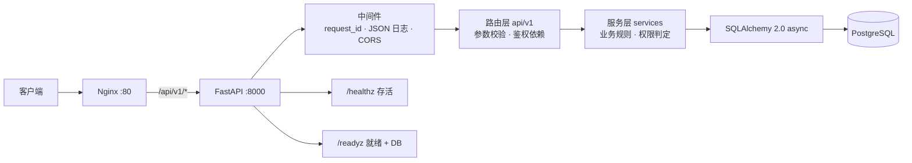

# WorkFlowX · 任务协作平台后端

[](https://github.com/waka66/WorkFlowX/actions/workflows/ci.yml)

基于 FastAPI + PostgreSQL 的多租户任务协作后端。核心不是增删改查，而是**可配置的工作流状态机**与**四级权限判定**，配合统一错误码、结构化日志和存活/就绪探针，目标是「能被运维和测试接管」，而不只是「接口能跑通」。

- 43 个接口，`/api/v1` 版本化
- 37 个源文件约 6,700 行，17 个集成测试用例
- 110+ 个已登记业务错误码，187 处抛出点
- Python 3.12+ / PostgreSQL 16+

---

## 这个项目在解决什么问题

任务协作系统的难点不在增删改查，而在三件事：

1. **不同团队的流程不一样。** 有的团队只有「待办/进行中/已完成」，有的要加「待评审」「已阻塞」。所以状态机必须可配置，不能硬编码。
2. **「谁能把任务推进到下一步」因项目而异。** 同一个迁移，负责人可以做，普通成员不行。所以迁移规则要携带角色准入。
3. **出了问题要能查。** 所以每次响应带 `request_id`，日志结构化，异常分级归类，失败可归因而不是只看到一句 `Exception`。

---

## 核心设计

### 1. 可配置工作流状态机

```
workflows (1:1 项目)
  └─ workflow_statuses      key / name / order / is_initial / is_final
  └─ workflow_transitions   from_status_key → to_status_key / allowed_roles
```

任务迁移时按顺序校验：目标状态存在 → 不是自迁移 → 当前用户角色在 `allowed_roles` 内 → 写入活动与审计。

**取舍**：`allowed_roles` 存 JSON 数组而非关联表。优点是流程配置在一张表里改完即生效、免迁移；代价是无法做外键约束、无法直接索引（已记入「已知限制」）。

### 2. 四级权限判定

| 层级 | 管什么 | 载体 |
|---|---|---|
| 全局角色 | 平台运维、跨租户管理 | `users.global_role` |
| 团队角色 | 组织归属、成员增删 | `team_members.role` |
| 项目角色 | 协作范围、项目配置 | `project_members.role` |
| 迁移准入 | 流程节点由谁推进 | `workflow_transitions.allowed_roles` |

四层职责不重叠：越权读任务查项目层，改工作流查项目角色，推进节点查迁移规则。

### 3. 统一错误信封

所有错误响应形状一致，前端只需要一套解析逻辑：

```json
{"code": "TASK_TRANSITION_ROLE_DENIED", "message": "当前角色无权执行该流转", "request_id": "..."}
```

框架层异常（未携带 token、路由不存在）同样走这个信封 —— 注册在 `starlette.exceptions.HTTPException` 上，因此 FastAPI 的 `HTTPException` 与路由层 404 都被覆盖，而不是回落到 `{"detail": ...}`。

### 4. 可观测性

- `request_id` 通过 `contextvars` 贯穿请求生命周期，同时写入响应头 `X-Request-ID` 与每条日志
- 结构化 JSON 日志，按天轮转保留 30 天
- **日志初始化失败时降级为仅控制台输出**，不让只读文件系统把服务卡在启动阶段
- 探针职责分离：`/healthz` 不碰数据库，`/readyz` 才做连通性检查。若把查库放进存活探针，数据库抖动会导致容器被反复重启

---

## 架构



依赖方向单向：`api → services → models/db`，路由层不写业务逻辑，服务层不碰 HTTP。

---

## 技术栈

| 分层 | 选型 |
|---|---|
| Web | FastAPI、Uvicorn、Starlette 中间件 |
| 数据 | SQLAlchemy 2.0 async、asyncpg、Alembic |
| 校验 | Pydantic v2、pydantic-settings |
| 认证 | PyJWT（access + refresh）、passlib + bcrypt |
| 日志 | python-json-logger、TimedRotatingFileHandler |
| 工程 | uv、pytest + pytest-asyncio + httpx、GitHub Actions |
| 部署 | Docker Compose、Nginx 反向代理、PostgreSQL 16 |

---

## 快速开始

### 本地开发

```bash
uv sync --group dev

cp .env.docker.example .env    # 修改 DATABASE_URL / SECRET_KEY
uv run alembic upgrade head
uv run uvicorn app.main:app --reload
```

接口文档：`http://127.0.0.1:8000/docs`

### 容器部署

```bash
cp .env.docker.example .env.docker   # 修改密码与 SECRET_KEY
docker compose up -d --build
```

入口脚本会等待数据库就绪、执行 `alembic upgrade head`，然后启动应用；容器带 `HEALTHCHECK`，`docker ps` 可直接看到 `healthy`。

### 验证

```bash
curl -s localhost:8000/healthz     # {"status":"ok"}
curl -s localhost:8000/readyz      # 数据库不通时返回 503
```

---

## 测试

```bash
uv run pytest -q
```

17 个集成用例，覆盖：注册登录与 token、越权访问、工作流配置校验（初始状态唯一、状态 key 不重复）、任务迁移的角色准入与非法边、分页边界、附件上传与下载回读。

两个关键设计：

- **测试库隔离**：默认从 `DATABASE_URL` 推导出 `workflowx_test`，且库名必须包含 `test` 才允许执行，避免误连开发库删数据
- **用例可重复**：每个用例在外层事务内运行，结束后整体回滚，跑一万遍结果一致（这正是一次性 Postman 集合做不到的）

CI 使用 PostgreSQL service，先校验迁移可执行，再跑测试。

---

## 接口约定

- 前缀统一为 `/api/v1`
- 认证：`Authorization: Bearer <access_token>`
- 分页：`page`（≥1）、`page_size`（1–100），响应含 `total` 与 `has_more`
- 错误：统一 `{code, message, request_id}`，参数校验失败为 422 + `VALIDATION_ERROR`

---

## 性能基线

> ⚠️ 以下数据是**空表**基线（2026-09，本机 4 核），尚未在真实数据量下复测。真实数据量下的索引与查询计划验证列在 Roadmap 中。

环境：4 workers、连接池 `5 + 5`、PostgreSQL `max_connections=100`；接口 `GET /api/v1/auth/me`。

| 并发 | 中位数 | p95 | 吞吐 |
|---|---|---|---|
| 50 | 7.19 ms | 11.97 ms | 44 req/s |
| 100 | 5.88 ms | 10.49 ms | 82 req/s |
| 150 | 5.95 ms | 54.78 ms | 137 req/s |
| 200 | 5.70 ms | 51.26 ms | 172 req/s |
| 250 | 6.14 ms | 164.44 ms | 214 req/s |

结论：稳定并发约 200，稳定吞吐约 170 req/s。调参过程：连接池 `20+30 → 5+5`、workers `1 → 4`。

**为什么 5+5**：4 核配 4 workers，每个 worker 最多 10 条连接，`4 × 10 = 40 < max_connections(100)`，给迁移和管理连接留出余量；池子开太大反而让 PG 在连接调度上耗时，200 并发时 p95 从 51 ms 掉到 164 ms 就是回退信号。

---

## 已知限制

诚实记录，避免误用：

1. **服务层仍有超大模块**：`task_service.py` 约 1,450 行，混了工作流、任务 CRUD、评论、附件四块领域，待按领域拆分
2. **权限判定尚未收口**：角色判断散落在各 service 内，计划抽为 `core/permissions.py` 的纯函数以便单测
3. **性能基线是空表数据**：真实数据量下分页与过滤的复合索引未验证
4. **`allowed_roles` 用 JSON 存储**：灵活但无法外键约束，跨表一致性靠应用层保证
5. **附件存本机磁盘**：未接对象存储，多副本部署时不共享
6. **单机部署**：无熔断、无限流、无灰度；迁移在入口脚本执行，多副本同时启动会有并发迁移风险
7. **`datetime.utcnow()` 待替换**：写入的是 naive 时间，跨时区比较存在偏差

---

## Roadmap

- [ ] 拆分 `task_service`，抽出 `core/permissions.py` 并补单测
- [ ] 灌 10 万级数据复测分页与过滤，补复合索引并记录执行计划
- [ ] 前端管理后台（登录 / 项目列表 / 任务看板 / 工作流配置）
- [ ] 接入 Agent 运行记录：研究任务挂到项目下运行，平台侧承担触发鉴权、成本记录与审计

---

## 目录结构

```
app/
├── main.py              # 应用工厂：中间件、异常处理器、探针、路由挂载
├── core/                # 与业务无关的基础设施
│   ├── config.py        # 配置（连接池、CORS、日志、环境标识）
│   ├── security.py      # JWT 签发/解析、密码哈希
│   ├── exceptions.py    # 业务异常与错误码
│   ├── exception_handlers.py  # 业务异常 / 框架异常 / 校验异常 统一信封
│   └── middlewares.py   # request_id、结构化日志、CORS
├── db/                  # engine、session、Alembic 迁移
├── models/              # ORM 模型（user / team / project / task / system）
├── common/schemas.py    # Pydantic 请求与响应模型
├── api/v1/              # 路由层：只做参数接收与鉴权
└── services/            # 业务层：业务规则与权限判定
tests/
├── conftest.py          # engine / 事务回滚 session / ASGI client
└── test_api.py          # 17 个核心链路用例
```
